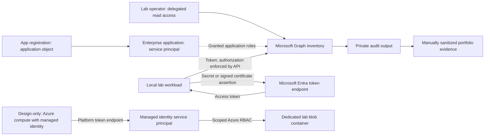
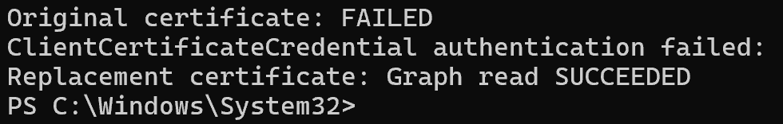

# Non-Human Identity & Workload Identity Security Lab

Project #8 | Identity Security Engineer portfolio | Fictional company: Northstar Lab

**Status: core Entra exercises validated through user-provided evidence, October 21–26, 2026.** Secret-to-certificate migration, certificate rotation, app-role review, expiry checks, workload activity investigation, and service-principal deactivation were demonstrated. The AD review used a disabled fixture. Azure managed identity remains **design-only**. See [results and limitations](docs/validation.md) and [portfolio narrative](PORTFOLIO.md).

Build an inventory of application identities, investigate risky credentials and permissions, and demonstrate safer authentication and accountable lifecycle management.

## Architecture

The application object defines the app; its service principal represents it in a tenant. They share an application/client ID but have different object IDs. Managed identities are service principals whose credentials Azure manages. Authentication proves identity; permission grants determine access.

## Build sequence

1. [Prepare and register the first app](docs/01-start-here.md).
2. [Compare secret and certificate authentication](docs/02-credentials.md).
3. [Audit credentials and effective permissions](docs/03-audit-and-permissions.md).
4. [Demonstrate managed identity](docs/04-managed-identity.md).
5. [Investigate inactivity, legacy accounts, and rotation](docs/05-lifecycle.md).
6. [Collect evidence](evidence/README.md) and complete [validation](docs/validation.md).

## Selected evidence

[Browse all captured evidence](evidence/README.md).

## Repository contents

- `scripts/Get-NhiCredentialReview.ps1`: read-only Graph credential inventory, or offline fixture analysis.
- `scripts/Get-NhiPermissionReview.ps1`: read-only review of granted app roles for one service principal.
- `samples/`: clearly labeled synthetic input and expected output.
- `docs/`: walkthroughs, design decisions, lifecycle runbook, and evidence-backed portfolio template.

Use a personal test tenant and fictional data. Azure resources can incur charges; the Azure branch is optional until a subscription and spending limit are established. Never publish secrets, tokens, private keys, raw tenant exports, or employer information. `.gitignore` is a convenience, not a secret scanner.

## References

Microsoft Learn, checked October 20, 2026:

- [Application and service principal objects](https://learn.microsoft.com/en-us/entra/identity-platform/app-objects-and-service-principals)
- [Register an application](https://learn.microsoft.com/en-us/entra/identity-platform/howto-create-service-principal-portal)
- [Manage app credentials](https://learn.microsoft.com/en-us/entra/identity-platform/how-to-add-credentials)
- [Client credentials flow](https://learn.microsoft.com/en-us/entra/identity-platform/v2-oauth2-client-creds-grant-flow)
- [List applications and required permissions](https://learn.microsoft.com/en-us/graph/api/application-list?view=graph-rest-1.0)
- [List service principal app role assignments](https://learn.microsoft.com/en-us/graph/api/serviceprincipal-list-approleassignments?view=graph-rest-1.0)
- [Service principal sign-in activity (beta)](https://learn.microsoft.com/en-us/graph/api/serviceprincipalsigninactivity-get?view=graph-rest-beta)
- [Managed identity overview](https://learn.microsoft.com/en-us/entra/identity/managed-identities-azure-resources/overview)

