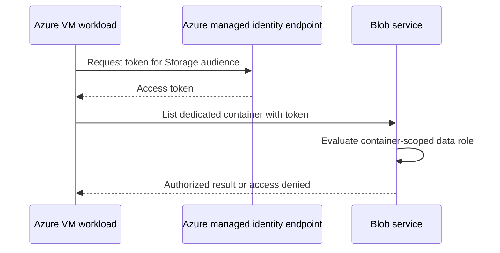

# Stage 4 — Azure managed identity branch

Requires a personal Azure subscription and a chosen budget. A budget alert is not a hard spending cap. If unavailable, mark this stage **design-only** and complete the Entra stages first.

1. Create a dedicated resource group `rg-nhi-lab` in a chosen region; record planned costs and deletion date. Reuse a personal lab VM only if appropriate, otherwise review VM, disk, network, and storage charges before creation.
2. Create a dedicated storage account and private blob container; disable anonymous public access. Upload a synthetic `hello.txt` as the operator.
3. On the Azure VM, open **Identity → System assigned → On → Save**. Record its principal ID privately.
4. At the dedicated container scope, assign that identity **Storage Blob Data Reader**. Avoid subscription-level roles and key-based storage access. Allow role propagation time.
5. Inside that VM, using the Az.Accounts and Az.Storage modules:

```powershell
Connect-AzAccount -Identity | Out-Null
$context = New-AzStorageContext -StorageAccountName (Read-Host 'Lab storage account') -UseConnectedAccount
Get-AzStorageBlob -Container (Read-Host 'Lab container') -Context $context | Select-Object Name,Length
```

6. Confirm `hello.txt` can be listed. For a negative test, have the operator prepare a second private container with no assignment for this identity; listing it should be denied. If it succeeds, inspect inherited RBAC before claiming least privilege. Do not display keys or access tokens.
7. Capture identity status, container-scoped assignment, successful read, and denied read. Remove role assignments and delete lab resources after collecting evidence. Verify removal and check for remaining disks, IPs, storage, and user-assigned identities.

System-assigned identities follow the resource lifecycle. User-assigned identities have independent lifecycles and can be shared, requiring explicit ownership and cleanup. Azure RBAC grants access to Azure resources; Microsoft Graph application roles are separate. Managed identity removes customer-managed credentials for this authentication path but does not remove permission or compromise risk.


